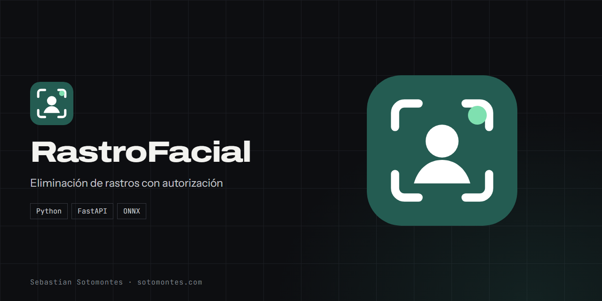
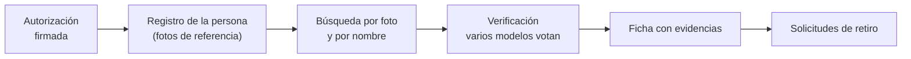

Herramienta privada para ayudar a una persona a encontrar y pedir la eliminación de sus fotos publicadas en internet, siempre con su autorización firmada.

| Ficha técnica | |
|---|---|
| **Autor** | Sebastian Sotomontes |
| **Tipo** | Privacidad y eliminación de rastros |
| **Plataforma** | Windows 10 y 11 |
| **Versión** | 2.6 |
| **Estado** | En uso privado |
| **Stack** | Python · FastAPI · ONNX Runtime (CPU) |
| **Código** | Privado. No se distribuye. |

---

## Qué es

RastroFacial es una herramienta de trabajo para un servicio de privacidad: ayuda a una persona que **lo pide y lo autoriza por escrito** a localizar dónde aparecen sus fotos en la web, para después solicitar que se retiren.

No es un buscador de personas. **Solo funciona con personas registradas** con un formulario de autorización firmado; cualquier otro rostro se rechaza y su imagen se descarta sin guardarse.

## Principios

- **Autorización primero**: sin consentimiento firmado no hay búsqueda.
- **Verificación por rostro**: cada resultado se confirma con varios modelos de reconocimiento que votan; los dudosos se marcan como tales y nunca se dan por buenos.
- **Mínimo de datos**: solo se guardan enlaces y el recorte de la cara necesario como evidencia, nunca el contenido completo.
- **Todo en un equipo**: la aplicación corre localmente, sin nube propia, y el panel solo responde desde ese computador.
- **Revocable**: la persona puede pedir que se borren sus fotos, su plantilla biométrica y sus resultados.

## Novedades

**Versión 2.6**

- Búsquedas que se pueden pausar y continuar, con resultados parciales.
- Fichas por persona con fotos verificadas, enlaces encontrados y evidencias en ZIP.
- Revisión de vídeos que la persona señala: localiza en qué minutos aparece para citarlo en la solicitud de retiro.
- Aplicación de escritorio sin instalador, con autoprueba de 140 comprobaciones.

## Cómo funciona por dentro

- Detección y reconocimiento facial con modelos ONNX en CPU; no requiere tarjeta gráfica.
- Umbrales calibrados con pruebas propias para separar "misma persona", "dudosa" y "otra persona".
- Interruptor de **uso comercial** que limita el motor a modelos con licencia que lo permite.

---

© 2026 Sebastian Sotomontes. Todos los derechos reservados.
